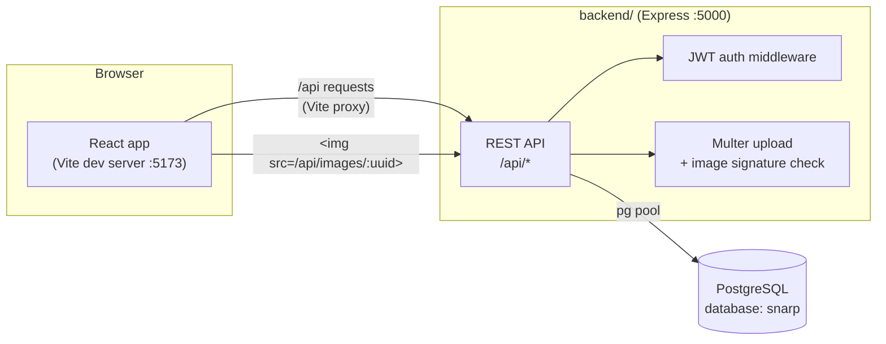
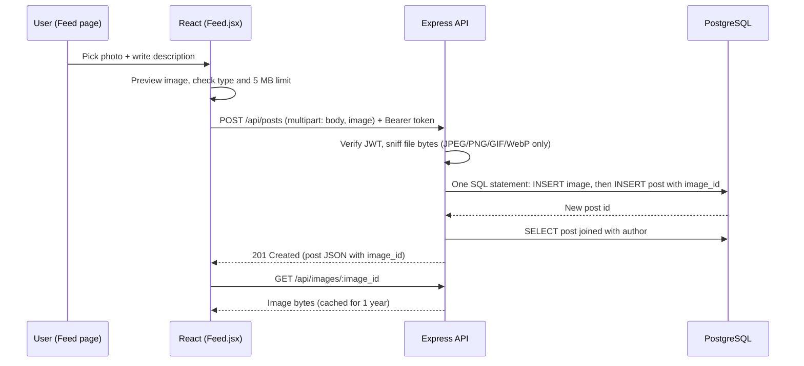

# SNARP: Social Networking & Academic Research Platform

An UptoSkills internship MVP where students and researchers share updates, publish research and connect with communities.

This README describes the project **as it stands today**: what works end to end, what is UI only, and how to run for it.

---

## Contents

- [Current status](#current-status)
- [Tech stack](#tech-stack)
- [Architecture](#architecture)
- [Getting started](#getting-started)
- [Database schema](#database-schema)
- [API reference](#api-reference)
- [Project structure](#project-structure)
- [Design system](#design-system)
- [Security notes](#security-notes)
- [Testing](#testing)
- [Production deployment](DEPLOYMENT.md)
- [Roadmap and known limitations](#roadmap-and-known-limitations)

---

## Current status

| Feature | Status | Notes |
|---|---|---|
| Landing page | ✅ Working | GSAP scroll animations, shown to logged-out visitors at `/` |
| Sign up / log in / log out | ✅ Working | bcrypt password hashing, revocable server-tracked JWT sessions, 1 or 7 day expiry |
| Feed: create text posts | ✅ Working | Up to 5000 characters |
| Feed: post images with a description | ✅ Working | JPEG, PNG, GIF, WebP up to 5 MB, stored in PostgreSQL as `BYTEA` |
| User profiles | ✅ Working | Persistent name, institution, department, bio, interests, skills, links and photo; public profiles show posts |
| Feed: create, edit and delete own posts | ✅ Working | Up to 5000 characters; deleting also removes the post's image |
| Feed: likes, comments and reports | ✅ Working | Persisted in PostgreSQL; comments can only be removed by their author; duplicate reports are blocked |
| Feed pagination | ✅ Working | Mixed post and approved-paper feed, 20 items per page |
| Citation tools (APA / BibTeX) | ✅ Working | Runs in the browser, needs no backend |
| Communities | Implemented MVP | Create communities, join/leave, member discussions, owner editing and post moderation persist in PostgreSQL |
| Events | Implemented MVP | Upcoming events, author/moderator/admin publishing, event details, registration and capacity enforcement persist in PostgreSQL |
| Messages | Implemented MVP | Private one-to-one conversations persist; active threads refresh periodically |
| Notifications | Implemented MVP | Persisted like, comment, paper-review and message alerts with unread/read state |
| Submit a paper | Implemented MVP | Authenticated submissions save metadata and PDF bytes in PostgreSQL; new papers are pending |
| Paper moderation | Implemented MVP | Admin/Moderator dashboard includes submission/report queues, summary counts and review history |
| Settings, Help center | Partial | Profile photo uploads persist; other profile settings are UI only. FAQ and contact details are real |
| Search bar | Partial | Researchers, posts, communities, upcoming events and approved papers use PostgreSQL |

Sample data for the remaining UI-only modules lives in [`frontend/src/sample.js`](frontend/src/sample.js). Communities, profiles, the social feed, paper workflows and moderation use PostgreSQL-backed APIs.

Paper submission, review, approval/rejection, feed publication, search and PDF retrieval use PostgreSQL. Pending and rejected papers are excluded from public feed and search results.

---

## Tech stack

| Layer | Technology |
|---|---|
| Frontend | React 19, Vite, React Router 7, GSAP 3 (ScrollTrigger, ScrollSmoother, SplitText, DrawSVG, Flip), Phosphor Icons (app), Hugeicons (landing), Geist font (self-hosted) |
| Backend | Node.js 22.12+ (tested on 24), Express 5 |
| Database | PostgreSQL (all data, including images, lives here) |
| Auth | JWT (`jsonwebtoken`) and `bcryptjs` |
| Uploads | Multer (in-memory) with file-signature validation |

No external storage (Cloudinary, S3, R2) is used. **Everything is stored in PostgreSQL.**

---

## Architecture



- In development, Vite proxies every `/api` request to `http://localhost:5000` (see [`frontend/vite.config.js`](frontend/vite.config.js)), so there are no CORS issues. In production, serve the frontend and `/api` through the same origin or configure a reverse proxy.
- **The backend sets itself up on start.** It connects to the `postgres` maintenance database, creates the `snarp` database if it does not exist, then creates or upgrades the tables. If everything already exists, it does nothing.
- In local development, the backend generates a random `JWT_SECRET` and saves it to `backend/.env` when none is set. Production must provide a unique secret of at least 32 bytes through the deployment environment or a secret manager.
- Signup and login use in-memory rate limits. Configure `TRUST_PROXY` only when deployed behind a trusted reverse proxy; use its hop count or explicit trusted proxy IP/CIDRs. The built-in store is suitable for a single process, not shared across multiple instances.

### Request flow: creating an image post



---

## Getting started

### Prerequisites

- **Node.js 22.12 or newer** (the backend uses `--env-file-if-exists`)
- **PostgreSQL** running locally (any recent version with `gen_random_uuid()`, so 13+)

### 1. Install dependencies

```bash
cd frontend
npm install
cd ../backend
npm install
```

### 2. Configure the database connection

```bash
cd backend
cp .env.example .env
```

Edit `backend/.env`:

```env
PGHOST=localhost
PGPORT=5432          # check your postgresql.conf, some installs use 5433 or 5434
PGUSER=postgres
PGPASSWORD=your_password
PGDATABASE=snarp     # local development can create it; production should pre-create it
PORT=5000
PGPOOL_MAX=10        # max PostgreSQL connections per backend process
# Local development generates JWT_SECRET automatically on first run.
# Production must set a unique value of at least 32 bytes.
# JWT_SECRET=
# Set only behind a trusted proxy; use a hop count or trusted proxy IP/CIDRs.
# TRUST_PROXY=
```

> Forgot your postgres password? See [Resetting the postgres password](#resetting-the-postgres-password).

### 3. Run

Use two terminals:

```bash
# Terminal 1: backend
cd backend
npm start            # or: npm run dev (restarts on file changes)
```

On the first run you should see:

```
Created database snarp
API running on http://localhost:5000
```

```bash
# Terminal 2: frontend
cd frontend
npm run dev
```

Open **http://localhost:5173**, create an account, and post.

### Available scripts

| Where | Command | What it does |
|---|---|---|
| frontend | `npm run dev` | Start the Vite dev server |
| frontend | `npm run build` | Production build into `frontend/dist/` |
| frontend | `npm run lint` | ESLint over frontend source |
| frontend | `npm test` | Citation helper tests |
| backend | `npm start` | Start the API |
| backend | `npm run dev` | Start the API with auto-restart |
| backend | `npm test` | Validation, session, discovery and migration-runner unit tests |

### Resetting the postgres password

1. Open `C:\Program Files\PostgreSQL\<version>\data\pg_hba.conf` as Administrator.
2. Change `scram-sha-256` to `trust` on the `127.0.0.1/32` and `::1/128` lines, then restart the service (`Restart-Service postgresql-x64-<version>` in an admin PowerShell).
3. Run `psql -U postgres -p <port> -c "ALTER USER postgres PASSWORD 'new_password';"`
4. **Change `trust` back to `scram-sha-256`** and restart the service again.

---

## Database schema

The backend creates the database if needed, then applies ordered SQL files from [`backend/migrations/`](backend/migrations/). Applied filenames are recorded in `schema_migrations`; a PostgreSQL advisory lock prevents two server instances from applying the same migration at once. Migration `001_initial_schema.sql` also upgrades databases created by the earlier startup-based setup without dropping existing rows.

```mermaid
erDiagram
    users ||--o{ posts : "writes"
    users ||--o{ images : "uploads"
    users ||--o{ papers : "submits"
    users ||--o{ auth_sessions : "has sessions"
    users ||--o| user_profiles : "has profile"
    users ||--o{ comments : "writes"
    users ||--o{ likes : "likes"
    users ||--o{ reports : "reports"
    users ||--o{ communities : "creates"
    users ||--o{ community_members : "joins"
    users ||--o{ community_posts : "writes"
    communities ||--o{ community_members : "has members"
    communities ||--o{ community_posts : "hosts"
    users ||--o{ conversations : "participates"
    conversations ||--o{ conversation_members : "tracks reads"
    conversations ||--o{ messages : "contains"
    users ||--o{ notifications : "receives"
    users ||--o{ events : "organizes"
    users ||--o{ event_registrations : "registers"
    events ||--o{ event_registrations : "has attendees"
    posts ||--o{ comments : "has"
    posts ||--o{ likes : "receives"
    posts ||--o{ reports : "is reported"
    images |o--o| posts : "attached to"

    users {
        SERIAL id PK
        VARCHAR(100) name "NOT NULL"
        VARCHAR(255) email "NOT NULL, UNIQUE"
        TEXT password_hash "bcrypt hash"
        VARCHAR(20) role "admin | moderator | author | user"
        TIMESTAMPTZ created_at "DEFAULT now()"
    }

    auth_sessions {
        UUID id PK "JWT session id"
        INTEGER user_id FK "users.id, ON DELETE CASCADE"
        TIMESTAMPTZ created_at
        TIMESTAMPTZ expires_at
        TIMESTAMPTZ revoked_at "nullable"
    }

    user_profiles {
        INTEGER user_id PK, FK
        VARCHAR institution
        VARCHAR department
        TEXT[] research_interests
        TEXT bio
        TEXT[] skills
        JSONB links
    }

    posts {
        SERIAL id PK
        INTEGER user_id FK "users.id, ON DELETE CASCADE"
        TEXT body "max 5000 chars, may be empty if image present"
        UUID image_id FK "images.id, ON DELETE SET NULL, nullable"
        TIMESTAMPTZ created_at "DEFAULT now()"
        TIMESTAMPTZ updated_at
    }

    comments {
        BIGSERIAL id PK
        INTEGER post_id FK
        INTEGER user_id FK
        VARCHAR body
        TIMESTAMPTZ created_at
        TIMESTAMPTZ updated_at
    }

    likes {
        INTEGER post_id PK, FK
        INTEGER user_id PK, FK
        TIMESTAMPTZ created_at
    }

    reports {
        BIGSERIAL id PK
        INTEGER post_id FK
        INTEGER reported_by FK
        VARCHAR reason
        VARCHAR status
        TIMESTAMPTZ created_at
    }

    communities {
        BIGSERIAL id PK
        VARCHAR name "unique"
        VARCHAR category
        INTEGER created_by FK
        TIMESTAMPTZ created_at
    }

    community_members {
        BIGINT community_id PK, FK
        INTEGER user_id PK, FK
        VARCHAR role
        TIMESTAMPTZ joined_at
    }

    community_posts {
        BIGSERIAL id PK
        BIGINT community_id FK
        INTEGER user_id FK
        VARCHAR body
        TIMESTAMPTZ created_at
        TIMESTAMPTZ updated_at
    }

    conversations {
        BIGSERIAL id PK
        INTEGER user_one FK
        INTEGER user_two FK
        TIMESTAMPTZ created_at
    }

    conversation_members {
        BIGINT conversation_id PK, FK
        INTEGER user_id PK, FK
        TIMESTAMPTZ last_read_at
    }

    messages {
        BIGSERIAL id PK
        BIGINT conversation_id FK
        INTEGER sender_id FK
        VARCHAR body
        TIMESTAMPTZ created_at
    }

    notifications {
        BIGSERIAL id PK
        INTEGER user_id FK
        INTEGER actor_id FK
        VARCHAR kind
        BIGINT entity_id
        TIMESTAMPTZ read_at
    }

    events {
        BIGSERIAL id PK
        VARCHAR title
        TIMESTAMPTZ starts_at
        TIMESTAMPTZ ends_at
        INTEGER capacity "nullable"
        VARCHAR status
        INTEGER created_by FK
    }

    event_registrations {
        BIGINT event_id PK, FK
        INTEGER user_id PK, FK
        TIMESTAMPTZ registered_at
    }

    images {
        UUID id PK "gen_random_uuid()"
        INTEGER user_id FK "users.id, ON DELETE CASCADE"
        VARCHAR(20) mime "detected from file bytes"
        BYTEA data "raw image bytes"
        TIMESTAMPTZ created_at "DEFAULT now()"
    }

    papers {
        BIGSERIAL id PK
        INTEGER user_id FK "users.id, ON DELETE CASCADE"
        VARCHAR(300) title "NOT NULL"
        TEXT abstract "NOT NULL"
        VARCHAR(255) doi "nullable"
        VARCHAR(120) domain "NOT NULL"
        TEXT[] tags
        JSONB authors
        BYTEA pdf_data "PDF, maximum 10 MB"
        VARCHAR(255) pdf_filename
        VARCHAR(20) status "pending, approved or rejected"
        INTEGER reviewed_by FK "users.id, nullable"
        TIMESTAMPTZ reviewed_at "nullable"
        TEXT rejection_reason "nullable"
        UUID idempotency_key "nullable, unique per user"
        TIMESTAMPTZ created_at
        TIMESTAMPTZ updated_at
    }
```



### Tables

#### `users`

| Column | Type | Constraints |
|---|---|---|
| `id` | `SERIAL` | Primary key |
| `name` | `VARCHAR(100)` | Not null |
| `email` | `VARCHAR(255)` | Not null, unique, stored lowercase |
| `password_hash` | `TEXT` | bcrypt hash (cost 10), never returned by the API |
| `role` | `VARCHAR(20)` | `admin`, `moderator`, `author` or `user`, default `user` |
| `created_at` | `TIMESTAMPTZ` | Default `now()` |

Sign-up only allows `user` or `author`. Admins and moderators must be promoted in the database:

```sql
UPDATE users SET role = 'moderator' WHERE email = 'someone@example.com';
```

#### `auth_sessions`

Each issued access token has a matching session row. Protected requests check that the session remains active and that the user's current role still grants access. Logout revokes the current session; expired and old revoked rows are pruned during sign-in. Remembered sessions expire after 7 days; unchecked “Keep me logged in” sessions expire after 24 hours. Tokens issued before this session check was deployed must be replaced by signing in again.

#### `user_profiles`, `likes`, `comments`, and `reports`

Migration 002 stores optional academic profile fields separately from account credentials. Likes are unique per user and post; comments are owned by their author and cascade with deleted posts. Users can report another user's post once. Moderators can mark reports reviewed or dismissed.

#### `paper_reviews` and `audit_logs`

Migration 003 stores every paper approval/rejection with its reviewer and comment. Sensitive moderation actions and report dispositions also create audit records. Audit log access is admin-only; role promotion remains an out-of-band database operation.

#### `communities`, `community_members`, and `community_posts`

Migration 004 persists community metadata, owner/member roles, and paginated discussions. Community creators are owners; only members can publish discussions. Owners and platform moderators can edit communities and remove community posts. Owners cannot leave until ownership transfer is available.

#### `conversations`, `messages`, and `notifications`

Migration 005 stores private one-to-one conversation membership and message read timestamps. Notifications are recipient-scoped and store read timestamps; likes, comments, paper decisions and direct messages create alerts. Message access is checked against conversation membership on every API request.

#### `events` and `event_registrations`

Migration 006 stores scheduled academic events and unique attendee registrations. Registration locks the event row before checking capacity, so simultaneous signups cannot exceed a configured limit. Organizers and platform moderators can edit or cancel events; registration closes when an event starts or is cancelled.

#### `posts`

| Column | Type | Constraints |
|---|---|---|
| `id` | `SERIAL` | Primary key |
| `user_id` | `INTEGER` | References `users(id)`, cascade delete |
| `body` | `TEXT` | Default `''` |
| `image_id` | `UUID` | References `images(id)`, set null on delete, optional |
| `created_at` | `TIMESTAMPTZ` | Default `now()` |

- **`posts_content_check`**: `length(body) <= 5000 AND (trim(body) is not empty OR image_id IS NOT NULL)`. A post needs text, an image, or both.
- **Index**: `posts_created_at_idx` on `created_at DESC` for the feed.

#### `images`

| Column | Type | Constraints |
|---|---|---|
| `id` | `UUID` | Primary key, `gen_random_uuid()` |
| `user_id` | `INTEGER` | References `users(id)`, cascade delete |
| `mime` | `VARCHAR(20)` | `image/jpeg`, `image/png`, `image/gif` or `image/webp` |
| `data` | `BYTEA` | Raw file bytes (max 5 MB, enforced by the API) |
| `created_at` | `TIMESTAMPTZ` | Default `now()` |

#### `papers`

Migration `001_initial_schema.sql` creates this table if it does not exist. It stores the uploaded PDF bytes directly in PostgreSQL `BYTEA`; submissions start as `pending`. The author is associated with the authenticated user. A nullable per-user idempotency key prevents repeated requests from creating duplicate rows.

| Column | Type | Notes |
|---|---|---|
| `id` | `BIGSERIAL` | Primary key |
| `user_id` | `INTEGER` | References `users(id)`, cascade delete |
| `title`, `abstract`, `domain` | `VARCHAR` / `TEXT` | Required paper metadata |
| `doi` | `VARCHAR(255)` | Optional validated DOI |
| `tags` | `TEXT[]` | Research keywords |
| `authors` | `JSONB` | Author names and optional affiliations |
| `pdf_data` | `BYTEA` | Validated PDF content, up to 10 MB |
| `pdf_filename`, `pdf_content_type`, `pdf_size` | `VARCHAR` / `INTEGER` | Original display name and validated PDF metadata |
| `additional_notes` | `TEXT` | Optional |
| `status` | `VARCHAR(20)` | `pending`, `approved`, or `rejected`; defaults to `pending` |
| `reviewed_by` | `INTEGER` | References the reviewing user, set to null if that user is deleted |
| `reviewed_at` | `TIMESTAMPTZ` | Set when a moderator approves or rejects |
| `rejection_reason` | `TEXT` | Visible to the submitting author in My submissions |
| `created_at`, `updated_at` | `TIMESTAMPTZ` | Default `now()` |

The optional `PAPER_MAX_PDF_BYTES` setting can lower the server upload limit; it is capped at 10 MB. The default is 10,485,760 bytes.

### Upgrades

Databases created by earlier versions of this project are upgraded by the first migration: the `image_id` and profile-photo columns are added when missing, the old post constraint is replaced, paper review columns and auth sessions are added, and indexes are created. Migration `002_profiles_and_social_feed.sql` adds profile fields, post timestamps, likes, comments and reports. Migration `003_moderation_dashboards.sql` adds durable paper review history and the admin audit log. Migration `004_communities.sql` adds communities, membership and discussions. Migration `005_messages_notifications.sql` adds private conversations, messages and notifications. Migration `006_events.sql` adds events and capacity-aware registrations. Migration `007_user_timeline_indexes.sql` adds indexes for user timelines and submission history. The migration runner wraps each file and its version record in a transaction. Review any future migration for data compatibility before deploying it.

---

## API reference

Base URL: `http://localhost:5000/api` (or `/api` through the Vite proxy).

Authenticated routes need the header `Authorization: Bearer <token>`. Errors always return JSON: `{ "error": "message" }`.
Profile photos are stored in the `images` table. Their UUID image URLs are unguessable and can be loaded by the browser without an auth header, like post images.

| Method | Path | Auth | Body | Success response |
|---|---|---|---|---|
| `GET` | `/health` | No | | `200 { status: "ok" }` when PostgreSQL is reachable; otherwise `503` |
| `POST` | `/auth/signup` | No | JSON `{ name, email, password, role? }` | `201 { token, user }` |
| `POST` | `/auth/login` | No | JSON `{ email, password, remember? }` | `200 { token, user }` |
| `POST` | `/auth/logout` | Yes | | `204`; revokes this session token |
| `GET` | `/auth/me` | Yes | | `200 { id, name, email, role, created_at, avatar_url, institution, department, research_interests, bio, skills, links, post_count }` |
| `PUT` | `/auth/me` | Yes | JSON profile fields: `name`, `institution`, `department`, `bio`, `research_interests[]`, `skills[]`, `links[]` | Updated profile |
| `PUT` | `/auth/me/photo` | Yes | `multipart/form-data`: `photo` (JPEG, PNG, GIF or WebP, max 5 MB) | `200 { avatar_url }` |
| `GET` | `/users/search?q=...` | Yes | | Up to 20 matching public researcher profiles |
| `GET` | `/users/:id` | Yes | Optional `post` query to include a shared older post | Public profile and up to 20 posts; email is not included |
| `GET` | `/posts?page=1` | Yes | Optional page number | `{ items, page, hasMore }`; 20 mixed posts/papers per page |
| `POST` | `/posts` | Yes | `multipart/form-data`: `body` (text), `image` (file, optional) | `201 post` |
| `PATCH` | `/posts/:id` | Yes (owner) | JSON `{ body }` | Updated post |
| `DELETE` | `/posts/:id` | Yes (owner) | | `204` |
| `PUT` | `/posts/:id/like` | Yes | JSON `{ liked: boolean }` | Current like state and count |
| `GET` | `/posts/:id/comments` | Yes | | Up to 50 comments |
| `POST` | `/posts/:id/comments` | Yes | JSON `{ body }` | `201 comment` |
| `DELETE` | `/comments/:id` | Yes (owner) | | `204` |
| `POST` | `/posts/:id/report` | Yes | JSON `{ reason }` | `201 { id, status }`; duplicate reports return `409` |
| `GET` | `/events?q=...&page=1` | Yes | Optional query/page/limit | Upcoming published events with registration counts and current user's registration state |
| `POST` | `/events` | Author/Moderator/Admin | JSON event fields: `title`, `description`, `kind`, `location`, `startsAt`, `endsAt`, optional `capacity` | `201 event`; organizer is the creator |
| `GET` | `/events/:id` | Yes | | Event details, registration count and management permission |
| `PATCH` | `/events/:id` | Organizer/Moderator/Admin | Full event metadata | Updated event; capacity cannot fall below registered attendees |
| `PATCH` | `/events/:id/cancel` | Organizer/Moderator/Admin | | Cancels the event and closes registrations |
| `PUT` | `/events/:id/registration` | Yes | JSON `{ registered: boolean }` | Registers or cancels the current user's registration; capacity is enforced |
| `GET` | `/messages/conversations` | Yes | | Conversations, last message and unread message count |
| `POST` | `/messages/conversations` | Yes | JSON `{ userId }` | Existing or newly-created one-to-one conversation |
| `GET` | `/messages/conversations/:id/messages?page=1` | Participant | Optional page/limit | Chronological messages; viewing marks the thread read |
| `POST` | `/messages/conversations/:id/messages` | Participant | JSON `{ body }` | `201 message`; notifies the other participant |
| `GET` | `/notifications` | Yes | Optional page/limit | Recipient's notifications and read state |
| `GET` | `/notifications/unread-count` | Yes | | Unread notification and message counts |
| `PUT` | `/notifications/:id/read` | Owner | | Mark one notification read |
| `PUT` | `/notifications/read-all` | Yes | | Mark all of the current user's notifications read |
| `GET` | `/communities?q=...&page=1` | Yes | Optional search query and page | Matching communities with member/post counts and current user's membership |
| `POST` | `/communities` | Yes | JSON `{ name, category, description? }` | `201 community`; creator becomes owner |
| `GET` | `/communities/:id` | Yes | | Community metadata, counts and current membership role |
| `GET` | `/communities/:id/members` | Yes | | Up to 100 members with community roles |
| `PATCH` | `/communities/:id/members/:userId/role` | Owner/Platform moderator | JSON `{ role: "moderator" | "member" }` | Updated community membership role; audited |
| `PATCH` | `/communities/:id` | Owner/Platform moderator | JSON `{ name, category, description }` | Updated community |
| `PUT` | `/communities/:id/membership` | Yes | JSON `{ joined: boolean }` | Join or leave; owners cannot leave |
| `GET` | `/communities/:id/posts?page=1` | Yes | Optional page/limit | Paginated public discussion feed |
| `POST` | `/communities/:id/posts` | Member | JSON `{ body }` | `201 discussion post` |
| `DELETE` | `/communities/:communityId/posts/:postId` | Author/Community owner/Moderator | | `204` |
| `GET` | `/images/:uuid` | No | | Image bytes with the correct `Content-Type` |
| `POST` | `/papers/submit` | Author | `multipart/form-data`: `title`, `abstract`, optional `doi`, `domain`, JSON `tags`, JSON `authors`, optional `additionalNotes`, `pdf` file; optional `Idempotency-Key` header | `201 { id, title, status, submittedAt }` (repeat key returns `200`) |
| `GET` | `/papers/my-submissions` | Yes | | Own submissions and review status/rejection reason only |
| `GET` | `/papers/search?q=...&author=...&domain=...&tag=...&sort=newest&page=1&limit=20` | Yes | All filters are optional; `sort` is `newest`, `oldest`, `title_asc`, or `title_desc`; `limit` is capped at 50 | `{ items, page, limit, total, hasMore }`; approved papers only |
| `GET` | `/papers/categories` | Yes | | Distinct categories used by approved papers |
| `GET` | `/papers/:id` | Yes | | Approved paper metadata and abstract; never includes PDF bytes or review notes |
| `GET` | `/papers/:id/pdf` | Yes | | PDF bytes for the submitting user, Admin/Moderator, or any authenticated user after approval |
| `GET` | `/moderation/papers?status=pending` | Moderator/Admin | Optional `status` (`pending`, `approved`, `rejected`, `reviewed`), `page`, `limit` | Paper metadata plus pagination; no PDF bytes |
| `GET` | `/moderation/papers/:id` | Moderator/Admin | | Full review metadata |
| `GET` | `/moderation/summary` | Moderator/Admin | | Counts for users, pending/reviewed papers and reports |
| `GET` | `/moderation/reports?status=pending&page=1` | Moderator/Admin | Status: `pending`, `reviewed`, or `dismissed`; optional page/limit | Reported post context and pagination |
| `PATCH` | `/moderation/reports/:id/:decision` | Moderator/Admin | Decision path: `reviewed` or `dismissed` | Updated report disposition; action is audited |
| `PATCH` | `/moderation/papers/:id/approve` | Moderator/Admin | Optional JSON `{ "comment": "..." }` | Atomic pending → approved decision with reviewer, history and audit record |
| `PATCH` | `/moderation/papers/:id/reject` | Moderator/Admin | JSON `{ "reason": "..." }` | Atomic pending → rejected decision with reviewer, history and audit record |
| `GET` | `/admin/audit-logs?page=1&limit=50` | Admin | Optional page/limit | Paginated moderation audit records |

Paper discovery supports title/abstract/DOI/author/domain/tag matching, exact category filtering, four sort orders and bounded page-based pagination. The PDF endpoint never returns pending or rejected papers to other users, and paper bytes are not included in metadata responses. PDF uploads are checked by their `%PDF-` signature, not their filename or client-provided MIME type. Only Admin/Moderator users can access moderation endpoints; discovery and detail queries filter to `approved` in SQL.

**Example: submit a paper with curl**

```bash
curl -X POST http://localhost:5000/api/papers/submit \
  -H "Authorization: Bearer $TOKEN" \
  -H "Idempotency-Key: 2c93e46c-44fd-4e95-92a2-e3584d2539df" \
  -F 'title=Research title' \
  -F 'abstract=Summary of the research.' \
  -F 'domain=Computer science' \
  -F 'tags=["systems","research"]' \
  -F 'authors=[{"name":"A. Researcher","affiliation":"UptoSkills"}]' \
  -F 'pdf=@paper.pdf;type=application/pdf'
```

Verify the metadata and stored PDF size in PostgreSQL:

```sql
SELECT id, user_id, title, status, pdf_filename, pdf_content_type,
       pdf_size, octet_length(pdf_data) AS stored_pdf_bytes, created_at
FROM papers
ORDER BY created_at DESC;
```

**Post object**

```json
{
  "id": 12,
  "body": "Our poster for the innovation challenge",
  "image_id": "47087733-d0e8-40a4-85b2-a685ff151dfa",
  "created_at": "2026-10-18T16:52:03.264Z",
  "user_id": 3,
  "author_name": "M. Jeevan Kumar",
  "author_role": "author"
}
```

**Validation rules**

| Field | Rule |
|---|---|
| `name` | 1-100 characters |
| `email` | Valid format, unique (`409` if taken) |
| `password` | 8-72 characters (bcrypt limit) |
| `role` | `author` or anything else becomes `user` |
| post `body` | Max 5000 characters; required unless an image is attached |
| post `image` | One file, max 5 MB, real JPEG/PNG/GIF/WebP bytes |

**Example: image post with curl**

```bash
curl -X POST http://localhost:5000/api/posts \
  -H "Authorization: Bearer $TOKEN" \
  -F "body=Our lab poster" \
  -F "image=@poster.png"
```

---

## Project structure

```
SNARP-Uptoskills/
├── backend/                  Express API (all Node.js code lives here)
│   ├── server.js             API routes, auth, uploads and error handling
│   ├── migrate.js            Ordered, transactional SQL migration runner
│   ├── migrations/           Versioned PostgreSQL schema changes
│   │   ├── 001_initial_schema.sql
│   │   ├── 002_profiles_and_social_feed.sql
│   │   ├── 003_moderation_dashboards.sql
│   │   ├── 004_communities.sql
│   │   ├── 005_messages_notifications.sql
│   │   ├── 006_events.sql
│   │   └── 007_user_timeline_indexes.sql
│   ├── migrate.test.js       Migration runner tests
│   ├── profile.js            Profile input validation
│   ├── profile.test.js       Profile validation tests
│   ├── community.js          Community and discussion input validation
│   ├── community.test.js     Community validation tests
│   ├── messaging.js          Direct-message input validation
│   ├── messaging.test.js     Messaging validation tests
│   ├── event.js              Event input validation
│   ├── event.test.js         Event validation tests
│   ├── paper-search.js       Approved-paper filters, sorting and pagination
│   ├── paper-search.test.js  Paper discovery query tests
│   ├── session.js            Session-bound JWT helpers
│   ├── image.js              Detects real image type from file bytes
│   ├── image.test.js         Tests for image.js
│   ├── .env.example          Template for backend/.env (copy and fill in)
│   ├── package.json
│   └── package-lock.json
├── frontend/
│   ├── public/                Favicon and shared SVG icons
│   ├── src/
│   │   ├── App.jsx            Routes and session restore
│   │   ├── main.jsx           Entry point, Geist font and global CSS
│   │   ├── api.js             API fetch wrapper and token storage
│   │   ├── Auth.jsx           Login and sign-up
│   │   ├── Feed.jsx           API-backed feed and image uploads
│   │   ├── Landing.jsx        Public landing page and animations
│   │   ├── Layout.jsx         Sidebar, top bar, mobile menu
│   │   ├── components/ui.jsx  Shared Avatar and PageHeader components
│   │   ├── pages/index.jsx    Communities, papers, events, messages and other pages
│   │   ├── assets/logo.png
│   │   └── supporting CSS, sample data, citation helpers and tests
│   ├── index.html
│   ├── vite.config.js         Dev proxy: /api -> localhost:5000
│   ├── eslint.config.js
│   ├── package.json
│   └── package-lock.json
├── .gitignore
├── .github/workflows/ci.yml   CI checks for backend and frontend
├── DEPLOYMENT.md              Production rollout and operations guide
└── README.md
```

### Frontend routes

| Path | Page | Backend |
|---|---|---|
| `/` (logged out) | Landing page | Not needed |
| `/login`, `/signup` | Auth | ✅ |
| `/` (logged in) | Feed | ✅ |
| `/communities` | Communities | Persistent community API |
| `/communities/:id` | Community detail | Membership and discussion APIs |
| `/articles` | Research papers | Approved paper API with filters and pagination |
| `/articles/:id` | Paper details | Approved paper detail and PDF APIs |
| `/events` | Events | Upcoming event and registration APIs |
| `/events/:id` | Event details | Event detail, registration and organizer APIs |
| `/messages` | Messages | Persistent one-to-one messaging API |
| `/notifications` | Notifications | Persistent alerts and read-state API |
| `/tools` | Citation tools | Not needed |
| `/submit` | Submit a paper | Authenticated submission API |
| `/my-submissions` | My submissions | Own submissions API |
| `/moderation` | Moderator/admin dashboard | Paper queue, report queue, summary; admin audit log |
| `/settings` | Settings | Profile fields and photo persist; notification settings are UI only |
| `/users/:id` | Researcher profile | Public profile and latest 20 posts |
| `/help` | Help center | Not needed |
| `/search?q=` | Search results | Researchers, posts, communities, upcoming events and approved papers APIs |

Logged-out users see the landing page at `/` and are redirected to `/login` from any app page; logged-in users visiting `/login` go to the feed.

---

## Design system

Light theme built from the UptoSkills logo. Solid colours only, no gradients.

| Token | Hex | Used for |
|---|---|---|
| `--orange` | `#f37346` | Brand orange: active nav icons, banners, highlights |
| `--orange-ink` | `#c2481a` | Primary buttons, badges (4.6:1 contrast with white) |
| `--teal` | `#2cbaa4` | Profile cover, community banners |
| `--teal-ink` | `#0f7666` | Secondary buttons, role labels |
| `--blue` | `#355fb5` | Links, author names |
| `--yellow` | `#fabb17` | Notices, moderation accents |
| `--bg` / `--surface` | `#f5f6f8` / `#ffffff` | Page background / cards |

- **Radius rule:** controls 8px, panels 14px, avatars round.
- **Font:** Geist Variable, self-hosted through `@fontsource-variable/geist`.
- **Icons:** Phosphor (`@phosphor-icons/react`).
- **Responsive:** the sidebar becomes a slide-out menu under 960px; the feed's right rail hides under 1180px.
- **Motion:** subtle post entry and skeleton loading in the app; disabled when the OS asks for reduced motion.

### Landing page animations

All animations live in [`frontend/src/Landing.jsx`](frontend/src/Landing.jsx) and use GSAP 3 with its free plugins (ScrollTrigger, ScrollSmoother, SplitText, DrawSVG, Flip). Landing icons come from Hugeicons. The landing page is lazy-loaded, so logged-in users never download GSAP.

Content is fully visible without JavaScript, and every animation (including smooth scrolling) is skipped when the OS has "reduce motion" turned on (`gsap.matchMedia`).

| Section | Animation |
|---|---|
| Whole page | Smooth scrolling (ScrollSmoother); the floating nav hides while scrolling down and returns on the way up |
| Hero headline | Letters rise out of masks; the last word cycles through *readers / peers / reviewers / citations* in a solid block that morphs width and colour |
| Hero network | A "You" node connected to peers: lines draw in, nodes pop, packets travel along edges and arrivals show what happened ("cited you", "+1 citation"); the graph tilts toward the pointer and scrolls at a slower speed |
| Word strip | Endless marquee of big words that speeds up and leans with scroll velocity |
| Feature cards | Five full-colour cards pin and stack on desktop, each new card burying the last; each plays its own story: photos deal in, an "Approved" stamp slams down, community chips reshuffle (Flip), a real citation types out in APA then BibTeX, notifications drop in |
| How it works | Pins and pans horizontally on desktop; each giant step word rises letter by letter as its panel arrives |
| Statement | Words fill from faint to solid as you scroll |
| Call to action | Heading rises line by line; buttons are magnetic (follow the pointer) |
| Footer | Giant SNARP wordmark rises letter by letter |


---

## Security notes

- Passwords are hashed with bcrypt and never returned by the API.
- Unknown-account login attempts also run a bcrypt comparison to reduce timing-based account discovery.
- Access tokens have a unique session ID stored in PostgreSQL. Every protected request checks its session and current account role; logout revokes the session immediately. Tokens created before this change do not have a session row and users must sign in again after upgrading.
- Paper submissions require the Author role at the API, regardless of what the frontend displays.
- Profile APIs never expose another user's email; profile links accept HTTPS URLs only. Post edits, comment deletion, and post deletion are checked against the authenticated owner in SQL.
- Every SQL query is parameterised.
- Production requires a unique `JWT_SECRET` of at least 32 bytes; local development generates one and saves it in `backend/.env`, which is **git-ignored**. Never commit `.env`.
- The API disables the Express version header and sends `nosniff`, same-origin frame, referrer, and permissions policy headers. Configure HTTPS, HSTS, and any Content Security Policy at the production proxy/static host.
- Signup is limited to 5 attempts per IP per hour and login to 10 failed attempts per IP per 15 minutes. Counters use the process's in-memory store and reset on restart. Use a shared store before running multiple API instances.
- `TRUST_PROXY` is unset by default. Set it only to the known proxy hop count or trusted proxy IP/CIDRs so the rate limiter sees client addresses without trusting arbitrary forwarded headers.
- Uploaded files are validated by their **actual bytes**, not the filename or browser-reported type. SVG and other formats are rejected, which prevents script injection through images.
- Images are served with `X-Content-Type-Options: nosniff`.
- Image URLs use random UUIDs so `` tags work without auth headers. Anyone with the exact URL can view that image (the same model most social platforms use).
- An image and its post are written in a single SQL statement, so a failure never leaves half-saved data.

---

## Testing

```bash
node --check backend/server.js
npm --prefix backend test
npm --prefix frontend test
npm --prefix frontend run lint
npm --prefix frontend run build
```

GitHub Actions runs those checks on pushes and pull requests. Backend unit tests cover validation, sessions, paper discovery SQL construction, and migration-runner behavior. Frontend tests cover citation helpers. These automated checks do not start PostgreSQL or test HTTP routes against a real database.

Earlier manual live-database checks documented in the project covered authentication, social posting and paper moderation workflows. Re-run the database-backed workflows against a disposable staging database after applying the latest migrations; Phase 10 did not connect to or migrate a live database.

Deployment steps, health checks, environment configuration, pool sizing, migration rollout, and operational limits are documented in [DEPLOYMENT.md](DEPLOYMENT.md).

---

## Roadmap and known limitations

Remaining roadmap work, following `social_Academic_Research_Platform_Roadmap.docx`:

- [ ] Upgrade message polling to Socket.IO for real-time delivery
- [ ] PostgreSQL full-text search
- [ ] Settings: update password and persist notification preferences
- [ ] Cursor-based feed pagination for consistent pages as new posts arrive
- [ ] Shared rate-limit storage before running multiple API instances
- [ ] Forgot password flow
